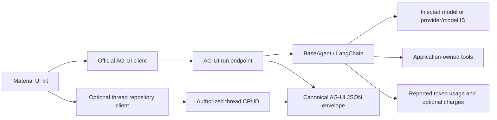

# Spaik 1.0 system architecture

Spaik focuses on thread management and a reusable UI kit with a small agent convenience layer.

The UI also connects directly to independent AG-UI backends. Thread listing/storage is optional for those integrations. Official message and event types replace the custom block protocol. Private provider replay/signature data stays outside public thread responses. Recording and tracing remain available.

The local runner coordinates one server process per repository. Applications supply distributed storage/run coordination for multi-worker deployments. File uploads and speech are separate optional routes. Provider SDKs are optional; the preset catalog is never an eligibility requirement. No price table or organization-billing allocation is maintained.

See [migration guidance](../MIGRATING_TO_1_0.md) and [release gates](../SPAIK_1_0_PLAN.md).
